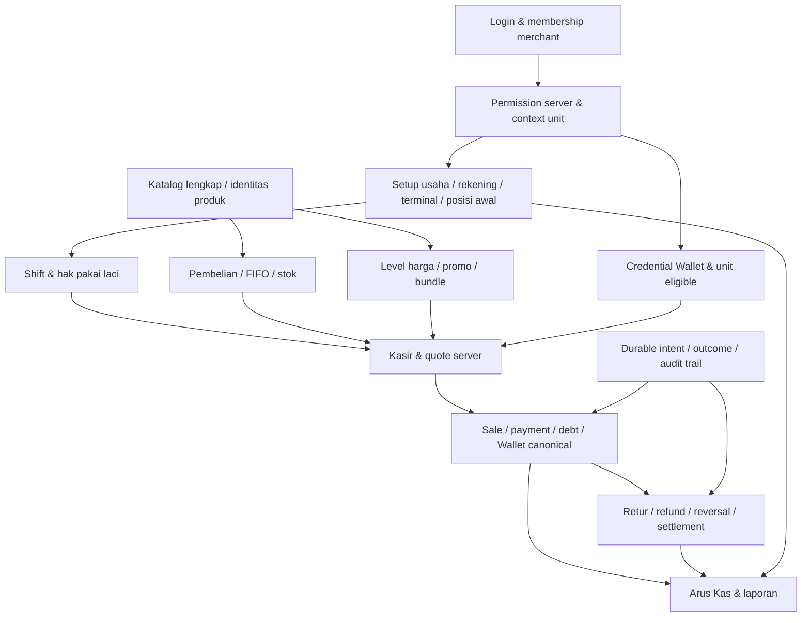

# SUQ SHOGIR — Final Product & Operational Audit

**Tanggal:** 3 November 2026, WIB. **Mode:** audit saja. **Status audit:** AUDIT COMPLETE, dengan batas bukti yang dinyatakan di bawah. **Status produk:** belum layak disebut final atau diterima untuk seluruh operasional.

Tidak ada perbaikan source, GRANT, migrasi, commit, build APK, atau deployment pada audit ini. Tidak ada transaksi finansial, import dummy, atau perubahan data production. Fixture lokal dijalankan dalam transaksi yang di-rollback.

## 1. Executive Summary

Masalah utama bukan kurangnya menu. Fondasi ledger, FIFO, pricing integer, refund, dan isolasi merchant sudah tersedia, tetapi alur kerja, cakupan data, otorisasi, dan pemulihan kegagalan belum membentuk satu produk operasional yang utuh.

Lima akar masalah paling berpengaruh:

1. **Status operasional yang dilihat Owner tidak mencakup konflik sumber daya.** Terminal dan laci Syirkah313 masih dipakai shift Kasir OPEN sejak 15 Oktober. Owner hanya melihat shift miliknya sendiri, sehingga diarahkan menekan Mulai Jualan yang kembali ditolak 409. Kontrol shift bekerja; penjelasan dan prosedur pemulihannya belum memadai.
2. **Daftar yang tampak lengkap sebenarnya merupakan potongan data.** Production memiliki **615 produk**, sedangkan API produk berhenti pada **200** dan API stok pada **300**. Pencarian aplikasi hanya menyaring data yang sudah dimuat. Ini memengaruhi Produk, Kasir, barcode, pembelian, stok, dan konfigurasi promo sekaligus.
3. **Pola navigasi memilih item tidak mengantar pengguna ke pekerjaan berikutnya.** Detail ditempel setelah daftar, editor bergantung pada posisi scroll, dan selector horizontal dipakai untuk data bisnis berjumlah ratusan. Struktur ini bertentangan dengan pekerjaan cepat di kantin.
4. **Kontrak backend belum selalu sesuai dengan janji UI dan permission.** Opname dihitung sebagai delta dari snapshot client; perubahan SKU/barcode pada editor biasa diabaikan; hak Kelola Harga belum melindungi endpoint master; harga beli referensi dikirim ke Kasir tanpa hak lihat HPP.
5. **Pemulihan dan pembuktian operasional tidak merata.** Penjualan dan sebagian formulir Keuangan memiliki jurnal retry, tetapi retur dan sejumlah mutasi lain tidak memperoleh perlindungan setara. Pesan generik menghilangkan konteks 409/permission. Signature dan tes otomatis belum membuktikan NFC atau import file asli di HP.

**Jumlah temuan:** P0 **0 terkonfirmasi**; P1 **8**; P2 **13**; P3 **1**. Total **22**. Nol P0 terkonfirmasi bukan bukti bahwa semua risiko finansial sudah ditutup. Tidak ditemukan bukti audit ini tentang kebocoran lintas tenant atau debit Wallet ganda di production; keduanya juga tidak boleh dinyatakan mustahil dari cakupan terbatas ini.

Prioritas adalah pemulihan shift yang dapat diaudit, keterjangkauan seluruh katalog, kontrak opname dan permission, serta recovery mutasi. Penyempurnaan visual dilakukan setelah kontrak bersama itu disepakati. Jangan menonaktifkan kontrol shift, mengubah saldo laporan, menghapus ledger, atau menutup shift lama secara otomatis untuk mengatasi gejala.

### Batas penafsiran

- **FACT:** dibuktikan pada source yang cocok dengan commit, metadata/log aktual, atau reproduksi baru pada clone.
- **SUSPECTED:** jalur risiko dapat ditunjukkan, tetapi dampak spesifik pada kejadian Owner belum terukur.
- **UNKNOWN:** membutuhkan akun, file, HP/kartu, bukti eksternal, atau instrumentasi yang tidak digunakan pada audit ini.
- **P0:** kerusakan finansial/akses kritis terkonfirmasi yang memerlukan penghentian segera. **P1:** blocker operasi atau risiko integritas/otorisasi penting. **P2:** hambatan alur, ketidakjelasan bisnis, atau gap kontrol yang berdampak nyata. **P3:** perbaikan dukungan operasional dengan dampak lebih rendah.

## 2. Baseline dan metode pembuktian

### 2.1 Identitas yang diperiksa

| Komponen | Hasil verifikasi |
|---|---|
| Canonical | `D:\0Aiki\Administrasi Santri Digital\klikpesantren` |
| Canonical checkout | `codex/ak01-ak02-academic-periods`, HEAD `2836413f583b36b3310024f8870052d6cb07e44b`; **bukan** source production POS |
| Perubahan canonical sebelumnya | `scripts/manage-academic-runtime-privileges.js` dan `services/academicReportService.js` sudah modified sebelum audit; tidak disentuh |
| Worktree SUQ | `D:\0Aiki\Administrasi Santri Digital\klikpesantren-suq-hotfix-deploy`, HEAD `9c546b1903ea9f0164f1f3752364ae7ec83c461f`; terdapat file untracked/staging/artefak, tidak dihapus |
| Backend production | `329028cb66d2665b38b036c8b7160bd8e53bec33` |
| Railway deployment aktual | `073dfd34-d36f-4f8b-8b1a-5cf78ec6dce1`, SUCCESS, 1 replica; diperiksa 3 November sekitar 07.51 WIB |
| API | `https://api.klikpesantren.com`; health HTTPS 200 pada audit |
| Database runtime | `neondb`, role `kp_app_runtime_20260917`; host Railway cocok dengan endpoint pooler Neon production yang sudah diverifikasi |
| Neon | project `fancy-river-27105749`, compute `ep-still-meadow-ao61w8sx`; pemeriksaan owner Direct READ ONLY dengan TLS diverifikasi |
| Schema ledger | 88 entri pada snapshot audit. Enam POS 116–121 dan akademik 110/111 sudah berada dalam baseline terdahulu; audit ini tidak mengulang rekonsiliasi semua checksum atau menjalankan migrasi |
| Mobile RC production | `b0885269c8b0bc2e55f0e27da3c0fdf2d5673c9e`, parent source v8 `9c546b19…` |
| APK yang dapat diperiksa | `artifacts/Suq-Shogir-Production-v9-Excel-Import-Fix.apk`, package `com.klikpesantren.pos`, versionCode **9**, versionName **1.0.0** |
| APK SHA-256 | `8F29E9CD4EF5040AB99665BE91FF50E0E8273357DA488FCEE3146F8223C71251` |
| Certificate SHA-256 | `4dcd327001be4bd60d7e9cd6f0894e943b77c0d9b7f6e862c0b8981d8ca7fee8`; signature diperiksa kembali, sesuai artefak v8 |
| Native APK | INTERNET, CAMERA, NFC tersedia; NFC ditandai optional. Binary native tidak otomatis membuktikan kompatibilitas HP/kartu |
| APK di HP Owner | **UNKNOWN** apakah keluhan terakhir memakai v8 atau v9; tidak dibaca dari perangkat. Jangan menyamakan RC yang tersedia dengan versi yang sudah terpasang |
| Clone reproduksi | `127.0.0.1:55439`, `suq_production_rc_ac8c7ae9d4_test`, effective runtime `suq_clone_runtime_7d4e9e147f`; identitas dicek sebelum fixture |

Cluster lokal existing sempat berhenti dan dinyalakan kembali pada loopback dengan data directory yang sama untuk fixture audit. Tidak dibuat cluster/database pengganti, tidak diubah konfigurasinya, dan tidak ada GRANT lokal pada reproduksi audit ini. PostgreSQL production tidak di-restart.

Clone berasal dari rehearsal sebelumnya, bukan snapshot baru production 3 November. Role clone adalah role terbatas existing; tidak diklaim identik dengan setiap ACL production terbaru. Dua izin SKU/barcode production diverifikasi terpisah. Reproduksi baru memakai jalur SQL/permission yang relevan dan tidak menjadi bukti rekonsiliasi seluruh data usaha saat ini.

### 2.2 Referensi source dan bukti

Nama source dalam laporan memakai pemetaan berikut agar tidak keliru membaca canonical HEAD:

- **B/** = source backend yang diverifikasi terhadap Git `329028cb…`, tersimpan untuk inspeksi di `.tmp/SUQ-IMPORT-HOTFIX-20261102/source/`.
- **M/** = source mobile yang diverifikasi terhadap Git `b0885269…`, di `.tmp/SUQ-IMPORT-HOTFIX-20261102/mobile/`.
- **E1** `.tmp/SUQ-PRODUCT-AUDIT-20261103/live-baseline.json` dan `runtime-target.json`: deployment, endpoint, target runtime aktual.
- **E2** `production-metadata.json`: snapshot read-only Syirkah313; ID dipseudonimkan, tidak mencatat saldo santri atau credential.
- **E3** `logs-http.json`: 2.000 baris log HTTP existing, rentang tersedia 2 November 16.04 sampai 3 November 07.44 WIB; 11 POST pembukaan shift berstatus 409. Jendela terbatas, bukan seluruh riwayat. Filter aplikasi `openShift` tidak menghasilkan rincian error terstruktur.
- **E4** `local-reproductions-resume.json`: reproduksi baru konflik shift, katalog 201→200, exposure harga beli, edit identitas, permission harga, opname stale, dan penolakan merchant asing. Semua fixture/operasi di-rollback. File kegagalan awal saat cluster lokal berhenti dipertahankan.
- **E5** `source-evidence.json`: 19 file hotspot cocok byte-for-byte dengan commit backend/mobile, serta hasil evaluasi fungsi pesan error aktual.
- **E6** `mobile-current-tests.log`: **138/138 tes mobile berjalan ulang saat audit**. Ini tes kontrak/algoritma/fixture, bukan bukti hardware atau transaksi production.
- **E7** APK existing diperiksa ulang dengan SHA-256, `apksigner verify`, `aapt dump permissions` dan `aapt dump badging`; tidak dibuat APK baru.

Tes lama dipakai hanya sebagai konteks, bukan bukti keluhan sudah selesai. Tidak digunakan credential testing/dummy pada production. Tidak ada debit, refund, settlement, perubahan nilai, atau penjualan production untuk audit.

### 2.3 Ringkasan reproduksi baru

| Skenario | Hasil saat audit |
|---|---|
| Kasir membuka shift Rp0 | HTTP 200 pada clone |
| Owner memakai terminal/laci yang sama | HTTP 409 `SHIFT_RESOURCE_IN_USE`; workspace Owner tetap `open_shift=null` |
| Owner menutup shift milik Kasir | HTTP 403 `SHIFT_DENIED`; tidak dilewati |
| Kasir menutup shift sendiri, lalu Owner buka Rp0 | HTTP 200; membuktikan Rp0 dan role Owner bukan penyebab penolakan |
| 201 produk, GET produk dan query SKU ke-201 | Respons 200 produk; query pencarian tidak menjangkau SKU terakhir |
| Kasir default tanpa PRODUCT_COST_VIEW | Respons katalog masih berisi `reference_purchase_price` |
| Edit SKU/barcode melalui editor biasa | HTTP 200 tetapi kedua nilai tidak berubah |
| Role eksplisit PRODUCT_VIEW + PRODUCT_MANAGE tanpa PRODUCT_PRICE_MANAGE | Perubahan harga master tetap HTTP 200 |
| Cached stok 10, mutasi lain membuat stok 9, hitung fisik 8 | Payload opname client OUT 2 diterima; stok akhir **7**, bukan 8 |
| Token merchant ke bisnis tenant lain | HTTP 403 pada pasangan fixture; bukan pembuktian semua endpoint |

## 3. Temuan per modul

### SQ-01 — Konflik shift lama tidak diterjemahkan menjadi alur pemulihan

- **Severity:** P1. **Aspek:** BUSINESS / UX / TECHNICAL.
- **Gejala:** Owner Syirkah313 gagal Mulai Jualan pada Kasir Utama, Kas Syirkah 313, kas awal Rp0.
- **FACT / akar:** snapshot production menunjukkan satu shift **CASHIER OPEN sejak 15 Oktober 2026 12.22 WIB**, memakai satu-satunya terminal dan laci. Izin INSERT shift dan lock terminal/laci tersedia; saldo ledger laci tidak negatif. Kode menolak tabrakan operator/terminal/laci. Rp0 diterima parser dan constraint. Owner workspace hanya menampilkan shift Owner sendiri. Fungsi close juga membatasi `user_id` operator; hak Owner saja tidak menyediakan takeover.
- **Bukti:** E2/E3/E4/E5; `B/services/posBusinessService.js:426 openShift`, `shiftRow/closeShift`; `B/services/posBusinessWorkspace.js:workspace`; `M/src/MerchantBusinessApp.jsx:580 Cashier`; `pos_business_shifts`, partial unique indexes `pos_business_shift_user/terminal/drawer`; POST `/:businessId/shifts/open` dan `/close`.
- **Batas:** log tidak merekam JSON response pada kejadian HP; kecocokan 409 dengan state dan reproduksi sangat kuat, bukan packet trace token Owner. Tidak dilakukan close production.
- **Dampak:** seluruh penjualan Owner terblokir; pengulangan tombol tidak menyelesaikan konflik. Shift lintas hari juga menyulitkan rekonsiliasi kas.
- **Rekomendasi:** tampilkan pemilik/status/umur pemakaian sumber daya sesuai otorisasi, opsi melanjutkan shift sendiri, serta prosedur tutup/handover terotorisasi setelah penghitungan kas. Jangan auto-close atau menghapus shift.
- **Acceptance:** kasus shift kosong/own-open/other-open/stale lintas hari menghasilkan tindakan yang jelas; Owner Rp0 bisa mulai hanya setelah konflik diselesaikan secara sah; semua handover memiliki actor, alasan, waktu, expected/actual cash dan audit trail.

### SQ-02 — Katalog dan pencarian terpotong di server, lalu dianggap lengkap oleh client

- **Severity:** P1. **Aspek:** BUSINESS / UX / TECHNICAL.
- **FACT / gejala:** merchant mempunyai 615 master produk pada snapshot, termasuk status yang belum dirinci. API katalog memakai `LIMIT 200`, stok `LIMIT 300`, movement stok `LIMIT 200`; pencarian produk di APK menyaring array lokal. Ini menjelaskan mengapa Owner merasa ada sekitar 200 produk. Bukan bukti bahwa 415 produk lain duplikat atau hilang dari database.
- **Bukti:** E2/E4; `B/services/posBusinessService.js:192 catalog`; `B/services/posBusinessWorkspace.js:inventory`; `M/src/MerchantBusinessApp.jsx:Products, Cashier, Inventory`; GET `/products`, `/inventory`. Fixture 201 produk mengembalikan 200 dan query SKU terakhir tidak membantu. Master `pos_business_products` tetap utuh.
- **Dampak:** produk di luar potongan tidak ditemukan pada Kasir, scan barcode, pembelian atau pemilihan promo. Menambah render halaman lokal tidak memuat sisa database. Filter Kasir juga hanya mengecek stok/pencarian, bukan `active && sellable`, sehingga barang berstok yang dilarang jual dapat tetap ditawarkan lalu ditolak pricing server.
- **Rekomendasi:** kontrak pencarian/pagination server bersama, total/has_more, filter eligibility dan status sesuai tugas; normalisasi response di semua modul. Pertahankan batas payload, jangan sekadar menghapus LIMIT.
- **Acceptance:** dataset 615+ dan 2.000 fixture dapat dicari sampai item terakhir menurut nama/SKU/barcode; pagination stabil tanpa duplikasi; barang nonaktif/tidak sellable tidak dapat dipilih sebagai barang jual; semua modul memakai identitas produk yang sama.

### SQ-03 — Opname bukan operasi hitung fisik atomik di server

- **Severity:** P1. **Aspek:** BUSINESS / TECHNICAL.
- **FACT / akar:** client menghitung `actual_stock - selected.on_hand` lalu mengirim adjustment relatif IN/OUT. Server tidak menerima baseline/version/count-time atau target absolut; reason hanya diberi awalan `OPNAME:`. Reproduksi menunjukkan hitungan fisik 8 dapat menjadi ledger 7 ketika baseline client tertinggal.
- **Bukti:** E4; `M/src/MerchantBusinessApp.jsx:Inventory payload` sekitar 704–707; `B/services/posBusinessService.js:adjustment, availableCost, consume`; POST `/stock-adjustments`; `pos_inventory_movements/layers/allocations`, operasi `STOCK_ADJUSTMENT`.
- **Dampak:** stok dan valuasi FIFO dapat salah walaupun transaksi secara SQL atomik. Riwayat tidak menyimpan seluruh konteks sesi hitung fisik.
- **Rekomendasi:** kontrak opname khusus dengan cutoff/baseline atau version check; server menentukan delta di bawah lock dan menolak data stale. Pilih kebijakan aktivitas saat hitung sebelum implementasi.
- **Acceptance:** perubahan stok concurrent menghasilkan 409/recount atau hasil yang mengikuti cutoff yang disepakati; tidak menerapkan delta lama diam-diam; simpan stok baseline, hasil fisik, delta, waktu, actor, alasan dan biaya selisih masuk.

### SQ-04 — Permission granular tidak konsisten dengan endpoint perubahan

- **Severity:** P1. **Aspek:** TECHNICAL / BUSINESS.
- **FACT / akar:** UI menawarkan PRODUCT_PRICE_MANAGE, tetapi `updateProduct` hanya memerlukan PRODUCT_MANAGE dan mengubah harga jual/reference price. Fixture role tanpa hak harga tetap berhasil mengubah harga. INVENTORY_OPNAME juga merupakan pilihan UI, sedangkan server menerima adjustment umum tanpa kontrak/permission opname tersendiri.
- **Bukti:** E4; `M/src/merchantAccess.cjs:GROUPS`; `B/services/posBusinessWorkspace.js:updateProduct`; `B/services/posBusinessService.js:adjustment`; POST `/products/:productId`, `/stock-adjustments`; model membership `permissions`.
- **Dampak:** Owner dapat memberi hak lebih besar dari yang dipahami dari checklist. Ini bukan bukti Kasir default saat ini mempunyai PRODUCT_MANAGE.
- **Rekomendasi:** tetapkan matriks field/action-capability di server; bedakan edit identitas, harga, biaya, dan opname; UI hanya menjadi representasi policy tersebut.
- **Acceptance:** role dengan hak edit identitas tetapi tanpa hak harga tidak dapat mengubah harga melalui request langsung; uji kombinasi permission negatif dan role eksplisit; perubahan ditolak atomik, bukan disimpan sebagian tanpa penjelasan.

### SQ-05 — Harga beli referensi bocor melalui proyeksi produk

- **Severity:** P1. **Aspek:** TECHNICAL.
- **FACT / akar:** katalog mengirim `reference_purchase_price` tanpa penyaringan PRODUCT_COST_VIEW. Fixture Kasir default menerima field tersebut. Inventory memakai `p.*` meskipun biaya movement disembunyikan.
- **Bukti:** E4; `B/services/posBusinessService.js:catalog`; `B/services/posBusinessWorkspace.js:inventory`; GET `/products`, `/inventory`; field `pos_business_products.reference_purchase_price`. Ini harga beli referensi, bukan pembuktian semua rincian FIFO/HPP telah terekspos.
- **Dampak:** pembatasan lihat biaya hanya di UI tidak melindungi data response.
- **Rekomendasi:** proyeksi allowlist server per capability; audit juga export, invoice dan nested payload. Jangan mengganti biaya yang ditolak dengan nol yang menyesatkan.
- **Acceptance:** request Kasir/custom role tanpa hak biaya tidak mengandung field reference cost/valuation yang dilindungi, termasuk export; role Owner berhak tetap memperoleh data yang diperlukan. Isolation lintas tenant tetap teruji.

### SQ-06 — Recovery mutasi dan request identity belum seragam

- **Severity:** P1. **Aspek:** TECHNICAL / UX.
- **FACT:** penjualan memakai `saleJournal` yang persisten; MoneyForm Keuangan juga mempunyai jurnal. Retur penjualan membuat UUID baru tiap konfirmasi dan callback membersihkan sumber/struk tanpa memeriksa hasil. AR/AP memakai UUID baru pada tombol; pembelian/stok memiliki tingkat stabilitas berbeda. Generic `run` menelan exception menjadi `undefined`, sedangkan `submit` menggabungkan POST dan refresh berikutnya dalam satu hasil.
- **SUSPECTED:** timeout setelah commit atau refresh gagal dapat mendorong pengulangan mutasi dengan identitas baru. Backend idempotency melindungi request yang sama, bukan intent pengguna yang sudah mendapat ID baru. Pada retur parsial, batas over-return bukan pengganti deduplikasi intent.
- **Bukti:** `M/src/MerchantBusinessApp.jsx:run, submit, Transactions, Purchases, Debts`; `M/src/saleJournal.cjs`; `M/src/FinancialWorkspace.jsx:MoneyForm`; `B/services/posBusinessService.js:beginOperation, returns`; `/sale-returns`, `/purchases`, `/debt-payments`, `/stock-adjustments`; unique `(business_id,request_id)`.
- **Batas:** tidak terjadi simulasi timeout/debit ganda di production; audit ini tidak menyatakan saldo production sudah terduplikasi.
- **Dampak:** risiko posting/refund berulang, kehilangan konteks, dan ketidakjelasan hasil mutasi.
- **Rekomendasi:** satu kontrak outcome COMMITTED/REJECTED/UNKNOWN, durable journal per intent untuk semua mutasi relevan, lookup hasil sebelum retry; kegagalan refresh tidak mengubah POST sukses menjadi gagal.
- **Acceptance:** putus koneksi sebelum/selama/setelah commit, app kill, navigasi dan ganti merchant tidak membuat ID baru untuk intent yang sama; tidak ada double stock/debt/Wallet/refund. Form dan audit reference dipertahankan sampai hasil pasti.

### SQ-07 — Kesiapan pembukuan awal belum jelas pada usaha berjalan

- **Severity:** P1. **Aspek:** BUSINESS / UX / TECHNICAL.
- **FACT:** Syirkah313 belum mempunyai `pos_business_initializations` dan `accounting_start_date` masih null. Pembukaan shift hanya menyimpan opening_cash; itu bukan setoran modal atau posting kas. Finalisasi posisi awal menolak jika ledger usaha telah beraktivitas.
- **Bukti:** E2; `B/services/posBusinessInitialization.js:status/finalize` (guard BUSINESS_ACTIVITY_ALREADY_STARTED); `B/services/posBusinessService.js:openShift`; `M/src/merchantBootstrap.cjs:READINESS_ITEMS`; `/initialization`, `/initialization/finalize`; tabel initializations, money/debt/inventory ledgers.
- **UNKNOWN:** kelengkapan saldo awal, stok historis, AR/AP dan modal secara ekonomi; audit tidak menghitung saldo santri atau mengubah transaksi asli.
- **Dampak:** Owner dapat salah menganggap kas awal shift sebagai aset/modal, atau menganggap laporan merepresentasikan seluruh usaha meskipun titik awal belum direkonsiliasi.
- **Rekomendasi:** rencana cutoff dan rekonsiliasi usaha berjalan yang disetujui Owner; jangan mengarang penjualan/pembelian lama atau mengosongkan ledger. Jelaskan cash float vs saldo kas vs setoran modal.
- **Acceptance:** baseline kas/bank, persediaan HPP, AR/AP dan equity terverifikasi dengan sumbernya; prosedur usaha berjalan aman bila ledger sudah aktif; laporan jelas membedakan catatan tersedia dari posisi usaha lengkap.

### SQ-08 — Lifecycle credential Wallet pada POS perlu disejajarkan dengan mandat Admin

- **Severity:** P1. **Aspek:** BUSINESS / TECHNICAL.
- **FACT:** `provision` dapat membuat opaque barcode credential bagi santri eligible dalam unit merchant, memakai alias `wallet.credentials.manage` → BUSINESS_SETTINGS_MANAGE. Source tidak meminta sesi Admin KlikPesantren pada route merchant ini. Revoke juga merupakan route merchant. Ini bukan endpoint topup atau perubahan saldo bebas.
- **Bukti:** `B/services/posBusinessWallet.js:authority, eligible, provision, revoke`; `B/services/posBusinessPermissions.js:LEGACY`; POST `/wallet/credentials`, `/wallet/credentials/:credentialId/revoke`; `pos_wallet_credentials`, `pos_wallet_credential_audits`.
- **SUSPECTED:** authority penerbitan credential yang terlalu luas dapat melemahkan bukti otorisasi pembayaran, bergantung proses penerbitan/distribusi yang benar-benar dipakai. Tidak dilakukan penerbitan credential atau debit pada production.
- **Dampak:** batas “Admin mengelola Dompet; POS hanya debit sah” belum sepenuhnya diterjemahkan ke lifecycle kartu/barcode.
- **Rekomendasi:** petakan penerbitan/pencabutan ke proses Admin yang disetujui, least privilege khusus, dan audit distribusi. Pertahankan canonical debit/refund dan unit eligibility.
- **Acceptance:** merchant tidak dapat membuat bukti pembayaran bagi santri di luar proses yang disetujui Admin; tanpa credential/eligibility sah debit ditolak; POS tidak memperoleh topup, ubah saldo bebas, atau akses lintas unit/tenant.

### SQ-09 — Detail/edit produk tidak memiliki fokus navigasi

- **Severity:** P2. **Aspek:** UX / OPERATIONAL.
- **FACT:** tap produk hanya mengubah selected. Detail Produk dirender **setelah List**. Editor dirender sebelum List, tetapi edit tidak menavigasi ke layar baru atau mengatur posisi scroll. Jadi detail tersembunyi di bawah, dan editor dapat muncul di luar viewport saat posisi tetap di bawah. List memakai PAGE_SIZE **30** dengan tombol memperpanjang daftar; bukan virtualisasi semua 615 produk sekaligus.
- **Bukti:** `M/src/MerchantBusinessApp.jsx:Products` sekitar 680–695, `List` 794; GET `/products`; E5. Gejala lapangan berasal dari Owner, tidak disimulasikan sebagai screenshot HP.
- **Dampak:** pengguna merasa tap tidak bekerja; risiko edit barang yang salah atau meninggalkan draft.
- **Rekomendasi:** detail dan edit sebagai layar/sheet berfokus dengan identitas produk, aksi utama, back dan restore posisi daftar. Jangan sekadar auto-scroll ke panel panjang.
- **Acceptance:** tap item mana pun membuka detail yang terlihat tanpa scroll manual pada 360×640 sampai 390×844; kembali mempertahankan pencarian/posisi; edit/save/cancel memiliki hasil yang jelas.

### SQ-10 — Selector horizontal tidak sesuai untuk data operasional besar

- **Severity:** P2. **Aspek:** UX / OPERATIONAL.
- **FACT:** SelectRows merender seluruh pilihan sebagai chip di ScrollView horizontal tanpa indikator. Dipakai pada stok, supplier, pembelian, akun dan invoice; beberapa caller mempunyai pencarian, tetapi komponennya sendiri tidak search/paging atau menunjukkan cakupan data.
- **Bukti:** `M/src/MerchantBusinessApp.jsx:SelectRows` 805, `Inventory/Purchases/Debts`; model produk/parties/invoices; GET `/inventory`, `/parties`, `/purchases`.
- **Dampak:** mencari barang jauh lambat dan pilihan terpilih mudah terlewat; perbaikan lokal tiap layar akan menghasilkan pola yang berbeda.
- **Rekomendasi:** satu selector vertikal searchable dengan nama/SKU/barcode dan secondary context, sumber pagination server, serta konfirmasi pilihan.
- **Acceptance:** 615+ opsi tidak menjadi chip horizontal; pilihan dapat ditemukan tanpa menggeser ratusan item; touch target/keyboard/back/selection restore diuji pada viewport kecil.

### SQ-11 — Pengaturan harga benar secara domain tetapi hubungan ke Kasir tidak terbaca

- **Severity:** P2. **Aspek:** BUSINESS / UX.
- **FACT:** PriceLevels menempatkan editor setelah daftar produk terfilter sampai 60; ProductPicker promo menampilkan sampai 40. Kasir memilih level per baris di panel transaksi; harga tidak otomatis mengikuti pelanggan. Server mengeksekusi quote dan snapshot, bukan hanya menu konfigurasi.
- **Bukti:** `M/src/PricingScreens.jsx:PriceLevels, ProductPicker, CashierPricePicker, Promotions`; `M/src/MerchantBusinessApp.jsx:Cashier`; `B/services/posBusinessPricing.js`, `posPricingEngine.js:calculatePricing`; `/pricing`, `/pricing/quote`, `/pricing/levels`, `/pricing/prices`, `/pricing/promotions`; `pos_price_*`, `pricing_snapshot`.
- **Batas:** 138 tes saat audit mencakup aturan pricing; tidak ada checkout fisik HP pada audit ini.
- **Dampak:** Owner tidak mengetahui apakah perubahan harga benar-benar diterapkan; editor tersembunyi dan katalog terpotong menambah kebingungan.
- **Rekomendasi:** task flow pilih produk → lihat semua harga → edit/preview → contoh penerapan Kasir; tampilkan harga umum, level terpilih, promo, total dan sumber aturan secara konsisten.
- **Acceptance:** contoh Aqua 5000, Member4500, Grosir4000, persen15%=4250 dan qty1–7 dapat ditelusuri dari konfigurasi ke quote, pembayaran dan struk; tidak memaksa customer atau stacking.

### SQ-12 — Editor SKU/barcode melaporkan sukses tanpa menyimpan field

- **Severity:** P2. **Aspek:** UX / TECHNICAL.
- **FACT:** form edit menampilkan SKU/barcode editable, sedangkan UPDATE endpoint biasa tidak menyertakannya. Reproduksi HTTP200 mempertahankan kedua nilai lama. Jalur Excel berbeda dan memang mempunyai kontrak update identitas.
- **Bukti:** E4; `M/src/MerchantBusinessApp.jsx:Products edit/save`; `B/services/posBusinessWorkspace.js:updateProduct`; POST `/products/:productId`; `pos_business_products.sku/barcode`.
- **Dampak:** scan atau pencarian memakai identitas lama sementara Owner merasa koreksi sudah disimpan.
- **Rekomendasi:** putuskan kapan identitas boleh berubah; selaraskan UI dan server dengan validasi konflik/audit. Jangan mengubah snapshot transaksi lama.
- **Acceptance:** field yang tidak didukung jelas read-only; field yang didukung disimpan atomik dan dikembalikan response; duplikasi lintas SKU/barcode satu merchant ditolak, histori lama tetap utuh.

### SQ-13 — Pesan error menghilangkan penyebab dan membawa konteks testing ke production

- **Severity:** P2. **Aspek:** UX / TECHNICAL.
- **FACT:** evaluasi errorText aktual untuk SHIFT_RESOURCE_IN_USE dan SHIFT_ALREADY_OPEN menghasilkan “Permintaan gagal…”. NETWORK_TIMEOUT selalu meminta memeriksa Alamat Server Pengujian, termasuk build production. makeApi membedakan HTTP status tetapi mengklasifikasikan semua exception tanpa status sebagai NETWORK, termasuk kesalahan serialisasi/programming.
- **Pemisahan penting:** kalimat tentang Alamat Server Pengujian tidak membuktikan APK production sedang memakai URL laptop. Artefak v9 yang terverifikasi memakai HTTPS production; versi/configuration pada HP Owner sendiri belum dibaca.
- **Bukti:** E3/E5; `M/src/MerchantBusinessApp.jsx:errorText, run`; `M/src/api.js:makeApi`; `B/routes/posBusinessRoutes.js:respondError`; generic log 500 hanya operation/INTERNAL.
- **Dampak:** operator mengulang tindakan yang salah; dukungan tidak dapat membedakan konflik, permission, upload lokal, cold start atau timeout.
- **Rekomendasi:** taxonomy transport/file/auth/domain/conflict/server/unknown-result, pesan kontekstual produksi, correlation ID aman dan tindakan pemulihan; jangan merekam credential/payload finansial sensitif.
- **Acceptance:** 401/403/409/413/422/500, invalid JSON, file-read failure dan timeout memberi pesan berbeda; 409 shift menyebut sumber daya terpakai; sesi tidak hilang karena timeout biasa.

### SQ-14 — NFC tidak otomatis aktif hanya karena kartu ditempel

- **Severity:** P2. **Aspek:** BUSINESS / UX.
- **FACT:** requestTechnology baru berjalan setelah tombol Baca NFC pada scanner pembayaran. Urutannya shift → barang → pembayaran Dompet → unit → Baca NFC → preview → konfirmasi. Merchant mempunyai enam tautan unit; jumlah unit aktif yang muncul pada context HP tidak diukur. Unit default kosong bila context berisi lebih dari satu unit. Scanner dapat disabled sebelum unit dipilih. Kegagalan shift Owner memblokir jalur menuju tahap ini.
- **Bukti:** E2; `M/src/MerchantBusinessApp.jsx:blankPayment, scanWallet, scannerAvailability, WalletCredentialScanner placement`; `M/src/WalletCredentialScanner.jsx:scanNfc`; POST `/wallet/preview`.
- **UNKNOWN:** layar dan status arming persis saat kartu Owner ditempel.
- **Dampak:** ekspektasi “tempel di mana saja” tidak cocok dengan reader foreground; pengguna tidak mengetahui apakah harus memilih metode/unit terlebih dahulu.
- **Rekomendasi:** alur pembayaran terarah dengan status belum siap/siap membaca/terdeteksi/verifikasi/ditolak dan alasan disabled; jangan aktifkan pembaca global yang dapat mendebit tanpa intent.
- **Acceptance:** operator dapat mencapai WAITING dan membatalkan; respons deteksi terbaca jelas; preview gagal tidak mendebit; context merchant/unit dipertahankan secara aman.

### SQ-15 — Kompatibilitas HP, kartu NFC dan barcode belum diterima secara fisik

- **Severity:** P2. **Aspek:** TECHNICAL / OPERATIONAL. **Status hardware:** UNKNOWN.
- **FACT:** permission NFC/native plugin tersedia; scanner meminta NfcA, memeriksa supported/enabled dan timeout 20 detik. UID hex dipertahankan urutan byte/nol awal. Barcode/QR harus opaque `kpw_…`, bukan sembarang nomor kartu. NFC optional pada manifest memungkinkan instalasi di HP tanpa NFC.
- **Bukti:** E7; `M/src/WalletCredentialScanner.jsx`, `paymentCredential.cjs`, `nfcFeedback.cjs`; `B/services/posBusinessWallet.js:input/resolve/eligible`; model santri UID, unit membership dan wallet credential.
- **UNKNOWN:** model HP, NFC aktif, frekuensi/protokol kartu, kesesuaian UID dengan reader existing, format barcode cetak, dan feature flag tiap unit. Nama RFID saja tidak membuktikan kompatibilitas NFC.
- **Dampak:** native build PASS dapat disalahartikan sebagai pembayaran kartu siap pakai.
- **Rekomendasi:** matriks perangkat/kartu nyata dan uji foreground/disabled/cancel/unknown card/insufficient balance; dokumentasikan kartu yang didukung, tanpa mencetak UID/token di laporan.
- **Acceptance:** bukti HP nyata untuk deteksi, preview, satu debit sah pada lingkungan dummy terisolasi, retry, refund dan session recovery; produksi hanya setelah persetujuan finansial yang sesuai. Tidak memerlukan USB/Expo Go/Metro untuk penggunaan normal.

### SQ-16 — Diskon manual keranjang campuran memerlukan keputusan eksplisit

- **Severity:** P2. **Aspek:** BUSINESS / UX.
- **FACT:** engine menerapkan promo pada Harga Umum, special price final dan paket nonstacking. `protected_pricing` berlaku pada seluruh keranjang jika ada satu bagian protected; UI meniadakan diskon manual seluruh keranjang, termasuk barang Harga Umum lain yang tidak berpromo.
- **Bukti:** `B/services/posPricingEngine.js:calculatePricing`; `M/src/MerchantBusinessApp.jsx:Cashier protectedPricing/discountValue`; `/pricing/quote`, `/sales`; snapshot per bagian.
- **UNKNOWN/policy:** apakah larangan seluruh keranjang campuran memang keputusan Owner atau hanya konsekuensi implementasi. Aturan anti-stacking tidak boleh diubah diam-diam.
- **Dampak:** Kasir mengira fitur diskon rusak ketika satu item khusus ditambahkan.
- **Rekomendasi:** konfirmasi policy, jelaskan alasan, dan bila diizinkan batasi alokasi diskon hanya ke bagian eligible dengan validasi server.
- **Acceptance:** semua kombinasi General/Member/promo/bundle menampilkan aturan yang sama di preview, total, pembayaran dan refund snapshot; tidak ada diskon bertingkat.

### SQ-17 — Metode pembayaran dan settlement belum menjadi proses rekonsiliasi yang utuh

- **Severity:** P2. **Aspek:** BUSINESS / UX.
- **FACT:** snapshot merchant hanya mempunyai akun CASH, belum BANK/QRIS. UI menawarkan pilihan Transfer, sedangkan penyelesaian membutuhkan akun sesuai metode dan konfirmasi manual. Backend memvalidasi `manual_confirmed`, `confirmation_mode=MANUAL`, reference dan nominal. QRIS pending dan Wallet clearing dibedakan dari kas/bank. Settlement Wallet dilakukan domain Admin dengan permission `pos.reconcile` dan guard tenant superadmin, bukan tombol merchant bebas.
- **Bukti:** E2; `M/src/paymentCredential.cjs:externalPayment`; `B/services/posBusinessService.js:sale`; `B/services/posBusinessWorkspace.js:settlementPosition`; `B/routes/posAdminRoutes.js`, `B/services/posAdminService.js:settleWallet`; accounts, payments, wallet links, settlement allocations/payouts.
- **UNKNOWN:** rekonsiliasi dengan bukti bank/provider dan settlement sebenarnya; tidak diuji memakai uang nyata.
- **Dampak:** metode terlihat siap walau setup belum ada; penerimaan QRIS manual bisa dianggap otomatis settled; refund setelah payout memerlukan recovery yang dipahami Owner.
- **Rekomendasi:** kesiapan metode berbasis akun dan kewenangan; checklist bukti penerimaan, pending/settled, biaya, payout dan recovery. Jangan menambah integrasi provider otomatis tanpa kebutuhan/keputusan.
- **Acceptance:** hanya metode siap yang dapat dipilih; transaksi QRIS belum settled tidak disebut saldo bank; payout/refund direkonsiliasi ke sumber dan akun tujuan tanpa double income atau double asset.

### SQ-18 — Retur tunai masih meminta identitas teknis operator

- **Severity:** P2. **Aspek:** UX / OPERATIONAL.
- **FACT:** formulir Retur Penjualan meminta “ID shift bila refund tunai”; pemilihan item memakai SelectRows horizontal. Sumber struk dipilih, tetapi operator tetap harus mengetahui ID teknis untuk kasus refund tunai.
- **Bukti:** `M/src/MerchantBusinessApp.jsx:Transactions` sekitar 645–651; POST `/sale-returns`; `B/services/posBusinessService.js:returns/shiftRow`; original sale, return lines dan money movements.
- **Dampak:** retur mudah gagal generik dan terdorong memakai jalur manual di luar sistem.
- **Rekomendasi:** pilih shift/laci yang sah dari context, tampilkan qty masih dapat diretur dan konsekuensi pengembalian uang. Domain refund tetap mengendalikan stok, FIFO, AR/AP dan Wallet.
- **Acceptance:** tidak ada input UUID manual; retur parsial/penuh memakai snapshot awal dan sisa qty aktual; pending outcome memakai jurnal yang sama dengan SQ-06; refund eksternal tidak diklaim otomatis mengembalikan uang.

### SQ-19 — Import/Export Excel sudah mempunyai hotfix tetapi acceptance file nyata belum dibuktikan

- **Severity:** P2. **Aspek:** UX / TECHNICAL / RELEASE.
- **FACT saat ini:** source v9 memakai File.bytes multipart yang didukung serializer Expo57, bukan URI-only v8. Izin UPDATE sku/barcode production sudah true. Enam tes serializer ikut berjalan ulang dalam 138 tes. Batas 2 MB/1.000 baris, header, string SKU/barcode, validasi preview, transaksi dan advisory lock import tersedia. Import mengubah master, bukan stok; export menambahkan kolom stok yang tidak menjadi perintah mutasi saat reimport.
- **Bukti:** E2/E5/E6/E7; `M/src/nativeUpload.cjs`, `MerchantBusinessApp:ProductWorkbookImport`; `B/routes/posBusinessRoutes.js:workbookFile`; `B/services/posProductWorkbookService.js:readRows/analyzeRows/productWorkbookCommit`; POST `/products/import/preview`, `/commit`, GET `/products/template.xlsx`, `/export.xlsx`.
- **UNKNOWN:** file asli Owner, versi terpasang, preview dan konfirmasi aktual setelah hotfix. Tidak menganggap laporan tes terdahulu sebagai bukti HP sudah berhasil. Download client juga merangkum banyak kegagalan HTTP sebagai REJECTED.
- **Dampak:** versi lama dan kegagalan transport dapat terus dianggap server rusak; perubahan massal memerlukan bukti dan kendali dampak yang jelas.
- **Rekomendasi:** acceptance file Owner pada v9 dengan preview/count/sumber harga yang dipahami, audit hasil per baris, serta outcome retry aman. Jangan auto-import atau overwrite stok melalui Excel.
- **Acceptance:** pilih file → upload → parse → validasi → preview → konfirmasi → cek hasil; SKU/barcode nol awal terjaga; duplikasi/konflik/oversize ditolak jelas; retry tidak menambah produk atau mengubah stok/FIFO. Data asli hanya diubah Owner sesuai preview dan izin terpisah bila diuji oleh tim.

### SQ-20 — Audit trail master produk/harga belum setara dengan ledger transaksi

- **Severity:** P2. **Aspek:** BUSINESS / TECHNICAL.
- **FACT source:** updateProduct melakukan UPDATE master tanpa before/after audit event eksplisit; pencatatan permission/credential mempunyai jalur audit tersendiri. Snapshot transaksi lama dipertahankan, tetapi tidak otomatis menjelaskan siapa mengubah master hari ini.
- **Bukti:** `B/services/posBusinessWorkspace.js:updateProduct`; `B/services/posBusinessPricing.js:savePrice/savePromotion`; `pos_business_products`, `pos_product_level_prices`, `pos_price_promotions`; bandingkan `pos_merchant_permission_audit` dan `pos_wallet_credential_audits`.
- **Batas:** tidak dilakukan audit database trigger menyeluruh; keberadaan audit eksternal lain adalah UNKNOWN, bukan dinyatakan pasti tidak ada.
- **Dampak:** Owner kesulitan menelusuri salah harga, import massal, atau perubahan SKU/barcode tanpa mengubah histori penjualan.
- **Rekomendasi:** event perubahan master terstruktur dengan actor, business, before/after yang aman, alasan/source import dan correlation ID; jangan membuat ledger saldo paralel.
- **Acceptance:** perubahan manual/import/harga/promo dapat ditelusuri per produk dan batch; histori penjualan tetap menggunakan original snapshot; akses audit dibatasi.

### SQ-21 — Laporan perlu dibedakan dari rekonsiliasi dan neraca lengkap

- **Severity:** P2. **Aspek:** BUSINESS / TECHNICAL.
- **FACT:** laporan memakai canonical dated operations, FIFO, debt dan money movements; mendukung periode/timezone serta kas/bank, QRIS pending, settlement receivable/recovery. UI menyebut “Hasil Usaha Operasional” dan “Aset Terpantau”, bukan janji neraca lengkap. `equation_balanced` dihitung dari equity yang memang diturunkan sebagai assets-liabilities, sehingga bukan bukti rekonsiliasi independen. Kerugian stok laba operasi menghitung DAMAGE; OUT generik tidak otomatis bermakna beban yang sama.
- **Bukti:** `B/services/posBusinessService.js:report` sekitar 582–734; `B/services/posBusinessFinance.js:range/balances/cashbook`; `M/src/FinancialWorkspace.jsx:Reports/Wealth`; GET `/reports`, `/cash-book`, `/books`; FIFO/debt/cash/settlement source tables.
- **UNKNOWN:** kecocokan saldo dengan kas fisik, bank, utang/piutang nyata, aset tetap, pajak/bunga/depresiasi dan baseline yang belum ada (SQ-07).
- **Dampak:** angka yang konsisten secara internal dapat disalahartikan sebagai seluruh laba/kekayaan usaha sudah benar secara ekonomi.
- **Rekomendasi:** prosedur rekonsiliasi kas/bank/stok/AR/AP/settlement dan batas cakupan laporan; klasifikasi koreksi OUT, DAMAGE, konsumsi, prive, pembelian stok dan expense; period close mengikuti keputusan Owner.
- **Acceptance:** periode harian/bulanan/tahunan saling merekonsiliasi, transfer tidak menaikkan laba, pelunasan tidak menghitung omzet ulang, cutoff jelas, aset tidak double count, dan residual/disclaimer menampilkan kekurangan data nyata tanpa saldo manipulatif.

### SQ-22 — Identitas release sulit digunakan oleh dukungan lapangan

- **Severity:** P3. **Aspek:** UX / SUPPORT.
- **FACT:** v8 dan v9 memakai versionName 1.0.0, dibedakan versionCode; header aplikasi tidak memberikan satu panel ringkas build/API/mode/status diagnosa. Audit dapat memverifikasi artefak, tetapi tidak mengetahui versi yang sedang dipakai Owner.
- **Bukti:** `M/app.config.js`; APK badging; `M/src/MerchantBusinessApp.jsx:header/Login`; API base berada pada embedded config.
- **Dampak:** keluhan sesudah hotfix sulit dikaitkan dengan binary/backend yang benar; produk signed dapat dianggap sudah diterima secara fisik.
- **Rekomendasi:** panel Tentang/Diagnostik read-only: versi/build, production/testing, domain API, last error/correlation ID dan panduan kartu yang didukung; tanpa token, UID atau password.
- **Acceptance:** Owner dapat mengirim identitas release dan kode error aman tanpa USB, Metro, akun teknis atau screenshot rahasia.

## 4. Analisis integrasi dan penilaian seluruh alur

### 4.1 Peta dependensi

Mengganti chip atau pesan saja tidak memperbaiki katalog yang terpotong, baseline opname stale, atau shift yang masih sah terikat operator lain. Sebaliknya, perbaikan SQL tanpa task flow tetap membuat operator tidak mengetahui cara melanjutkan.

### 4.2 Penilaian tiga aspek per alur

`PARTIAL` berarti ada kontrak/fungsi yang relevan tetapi ditemukan gap atau acceptance belum lengkap. `UNKNOWN` bukan FAIL. PASS di tabel dibatasi pada aspek yang dinyatakan; bukan seluruh end-to-end production.

| Alur | BUSINESS | UX / OPERATIONAL | TECHNICAL dan batas bukti |
|---|---|---|---|
| Login Owner/Kasir | PASS: identitas merchant terpisah dari Admin | PARTIAL: error/recovery generik | Login fixture baru PASS; login akun production tidak dicoba; membership/tenant guard sumber tersedia |
| Inisialisasi / modal / saldo awal | PARTIAL: bedakan float dan modal | PARTIAL: usaha berjalan tanpa baseline | Snapshot awal belum ada; finalize mempunyai guard dan immutable corrections; cutover belum diterima |
| Buka/tutup shift | PASS: operator/laci/terminal eksklusif perlu dipertahankan | FAIL untuk kasus Owner yang dilaporkan | Konflik409 dan legitimate recovery direproduksi; Rp0 sah; tidak menutup production |
| Produk/kategori/SKU/barcode | PARTIAL: identitas/kategori perlu policy | FAIL: detail tersembunyi, daftar terpotong | Cap200, update identitas diabaikan dan permission gap terkonfirmasi |
| Foto | PASS: mendukung identifikasi barang | UNKNOWN pada HP | Transport bytes diperiksa fresh unit test; kamera/galeri nyata tidak dijalankan |
| Import/Export | PASS: master saja, bukan stok | PARTIAL: acceptance versi/file | Hotfix source/ACL diperiksa; file asli HP belum diuji |
| Supplier/pembelian | PASS: stok dan AP dipisah dari expense | PARTIAL: selector dan konteks invoice | Kontrak invoice/FIFO/utang tersedia; dibatasi katalog dan recovery mutasi; tidak membeli di production |
| FIFO/persediaan | PASS: memakai biaya per layer, bukan harga jual | PARTIAL: riwayat dan pencarian terbatas | Source canonical allocation/lock ada; seluruh data ekonomi merchant belum direkonsiliasi |
| Koreksi/opname | PARTIAL: jenis koreksi/loss perlu diperjelas | PARTIAL: selector horizontal | FAIL pada stale opname yang direproduksi; permission khusus opname belum diterjemahkan |
| Level harga | PASS: dipilih Kasir per item tanpa customer | PARTIAL: editor tersembunyi dan panduan | Integer quote/snapshot ditinjau dan tes fresh; master-price permission gagal pada custom role |
| Persen/nominal/qty/bundle | PASS untuk aturan yang sudah diputuskan | PARTIAL: preview→Kasir belum dipahami | Tes source pricing dijalankan; acceptance HP belum ada; priority deterministik bukan otomatis termurah |
| Tunai | PASS: tender/change/shift | PARTIAL: Owner terblokir shift | Tidak dilakukan pembayaran nyata; fixture shift dan tes algoritma fresh tidak menggantikan acceptance kas |
| Transfer/QRIS manual | PARTIAL: bukti dan settlement harus dibedakan | PARTIAL: akun belum disiapkan | Confirmation/ref validasi server ada; bukan gateway/provider settlement otomatis |
| Wallet RFID/NFC/barcode | PASS hanya debit sah dan refund sumber asli | PARTIAL/UNKNOWN: prerequisites dan hardware | Unit/feature/credential/lock guard ada; device/kartu/UID nyata UNKNOWN; lifecycle credential perlu keputusan |
| Refund/reversal | PASS: domain terpisah, tanpa DELETE ledger | PARTIAL: UUID shift dan recovery | Source original snapshot, refund cap dan reversal legs tersedia; uncertain intent coverage gap; tidak diuji production |
| Retry/session persistence | PARTIAL: sebagian mutasi terlindungi | PARTIAL: generic submit menyembunyikan outcome | Sale/finance journal diuji fresh secara kontrak; belum merata untuk retur/pembelian/AR/AP/stok |
| Settlement Wallet | PASS: Admin berotoritas, merchant melihat posisi | PARTIAL: rekonsiliasi dan recovery perlu workflow | Source superadmin/tenant guard tersedia; payout/refund setelah payout secara nyata tidak dijalankan |
| Arus Kas / expense / other income / transfer | PASS: canonical money ledger, reversal terhubung | PARTIAL: proses audit pemilik usaha | Stable cursor/event view dan read projections tersedia; tidak mengklaim rekonsiliasi semua transaksi production |
| AR/AP | PASS: pelunasan terpisah dari omzet | PARTIAL: pilih invoice/akun dan retry | Debt movement canonical; invoice/history UI terbatas; no production collection/payment |
| Laba/modal/kekayaan usaha | PARTIAL: operating result dan tracked assets tepat cakupan | PARTIAL: baseline/close/reconcile belum lengkap | FIFO/cutoff/settlement diperiksa source; derived balance bukan audit eksternal |
| Struk Print/PDF/Share | PASS: keluaran histori, bukan posting baru | UNKNOWN pada printer/HP Owner | Mekanisme native dan snapshot source tersedia; tidak mencetak atau membagikan data production |
| Permission/audit trail/tenant | PARTIAL: granularitas perlu konsisten | PARTIAL: checklist menimbulkan ekspektasi berbeda | Cross-tenant fixture403; cost/price permission gap terkonfirmasi; shared DB role tidak sama dengan RLS universal |

### 4.3 Invariant yang wajib dipertahankan

- `pos_business_operations`, lines, payments, money/debt/inventory movements dan canonical Wallet tetap sumber kebenaran; jangan membuat saldo client atau ledger paralel.
- FIFO cost berasal dari layer/allocations; harga beli referensi bukan valuasi stok.
- Harga final/eligibility/nominal diverifikasi server. Snapshot receipt/pricing transaksi lama tidak ditulis ulang ketika master diubah.
- Wallet debit dan refund terkait transaksi sumber, memakai unit/tenant/account yang benar dan original intent ID. Pemindaian/preview tidak sama dengan persetujuan pembayaran.
- Transfer dua kaki/biaya dan reversal harus atomik; generic Arus Kas tidak membatalkan SALE/PURCHASE/Wallet/AR/AP tanpa prosedur domain.
- Merchant tidak memperoleh topup atau pengubahan saldo santri bebas. Settlement tetap memakai authority Admin yang sesuai.
- Backend predicate business/tenant/member harus diuji pada setiap fitur baru; satu fixture403 bukan audit menyeluruh seluruh ACL/RLS.

## 5. Keputusan kebijakan bisnis sebelum implementasi

### 5.1 Aturan yang sudah ditetapkan — jangan diputuskan ulang

Harga Umum adalah default dan referensi diskon; level dipilih Kasir per item, bukan assignment otomatis pelanggan; Member/Grosir/custom adalah harga final; tidak ada diskon bertingkat; bundle final tidak menerima promo komponen tambahan; server berotoritas atas harga/pembayaran; Wallet dikelola Admin, POS hanya debit sah; ledger dan snapshot historis tidak dihapus/ditulis ulang.

### 5.2 Hal yang masih memerlukan keputusan operasional Owner

| Keputusan | Pilihan/pertanyaan yang perlu dijawab | Batas yang tidak boleh dilanggar |
|---|---|---|
| Shift lama/handover | Siapa boleh menutup shift operator lain; hitung kas bersama; maksimal durasi dan penutupan harian; bagaimana menangani shift 15 Oktober | Tidak auto-close, force buka laci, menghapus shift atau mengganti actor lama |
| Cutover usaha berjalan | Tanggal baseline, dokumen kas/bank/stok HPP/AR/AP/modal; penanganan transaksi yang sudah tercatat | Tidak reset DB, membuat omzet palsu atau menganggap saldo kosong pasti benar |
| Identitas master | SKU/barcode boleh diubah kapan; normalisasi huruf, barcode ganda dan kategori standar | Snapshot penjualan lama tetap original; validasi merchant scope |
| Opname | Counting session/cutoff/freeze atau optimistic version; transaksi berjalan saat hitung; persetujuan selisih | Tidak menerapkan delta dari snapshot lama tanpa deteksi |
| Klasifikasi stok/biaya | DAMAGE vs koreksi OUT vs konsumsi internal/sampel/prive; pembelian stok vs expense | Tidak menghitung pembelian stok sebagai expense dua kali atau mengabaikan loss secara tidak sadar |
| Permission staf | Batas Kelola Produk, Kelola Harga, Lihat HPP dan Opname; hak supervisor/refund | Enforcement di server, bukan hanya menyembunyikan field |
| Credential Wallet | Bagaimana Admin menerbitkan/mencabut barcode/kartu dan memberikan scope merchant/unit; mandat bisnis untuk lifecycle credential pada POS | Bukan keputusan membuka hak ubah saldo ke POS; mandat Admin tetap berlaku |
| Diskon mixed cart | Apakah semua diskon manual memang diblokir bila ada satu protected item, atau hanya eligible General lines | Tidak stacking atau mengubah special/bundle final diam-diam |
| Promo conflict | Owner memahami priority DESC dan tie-break ID yang berlaku; apakah kebijakan itu diterima sebagai policy resmi | Jangan mengganti menjadi termurah atau menggabungkan promo tanpa persetujuan |
| Pembayaran/refund/settlement | Metode mana yang siap, bukti transfer/QRIS, cutoff payout, biaya dan recovery refund setelah payout | Tidak mengklaim uang eksternal sudah kembali hanya karena reversal tercatat |
| Tutup buku dan evaluasi | Kebutuhan rekonsiliasi periode, siapa menyetujui backdate dan dokumen yang membuktikan laba/aset | Tracked assets bukan neraca lengkap; derived equity bukan audit bank/stock |

## 6. Prioritas perbaikan dan ketergantungan

1. **Rencana operasional darurat yang direview, bukan dieksekusi dalam audit:** jelaskan konflik shift dan susun rekonsiliasi/handover shift lama bersama operator berwenang. Ini blocker langsung, bukan alasan melewati kontrol.
2. **P1 integritas dan otorisasi:** SQ-03/04/05/06/08. Kontrak opname, capability harga/biaya, lifecycle credential dan durable outcome harus disetujui sebelum memperluas penggunaan finansial.
3. **Fondasi data bersama:** SQ-02. Search/pagination/eligibility produk harus menjadi kontrak untuk seluruh Produk/Kasir/Stok/Pembelian/Pricing, bukan patch per layar.
4. **Alur task dan kesiapan:** SQ-07/09/10/11/12/13. Fokus detail/editor, selector bersama, baseline usaha, policy identitas dan error-recovery.
5. **Pembayaran yang dapat diterima secara operasional:** SQ-14/15/16/17/18/19. Setelah shift dan katalog beres, lakukan acceptance terisolasi pada perangkat/kartu nyata dan import asli yang disetujui.
6. **Auditabilitas dan rilis:** SQ-20/21/22, rekonsiliasi dan evidence pack lintas modul. Audit trail sensitif yang terkait P1 dikerjakan lebih awal bila menjadi dependensi.

Dependensi utama: **permission contract → endpoint/projection → shared data/search → task UI → hardware/financial acceptance → release**. Durable intent dan audit trail memotong semua workstream. Tidak disarankan membuat versi APK untuk satu gejala lalu baru memeriksa dependensi backend berikutnya.

## 7. Implementation Plan terintegrasi — belum dieksekusi

| Workstream | Scope terpadu | Dependensi dan deliverable |
|---|---|---|
| WS0 — Kontrak bisnis & evidence | Keputusan bagian5, baseline source/backend/mobile, error taxonomy/outcome dan daftar acceptance | Satu policy map dan test matrix disetujui; tidak membuka release gate baru tanpa alasan teknis |
| WS1 — Shift & readiness | Konflik resource, own shift resume, authorized close/handover, setup kas/terminal, cutoff posisi awal | Policy Owner/otorisasi; audit event; test normal/conflict/stale/network. Tidak mengubah histori atau auto-close |
| WS2 — Produk & shared selection | Search/cursor/total server, field projection, detail/edit terfokus, selector searchable, kategori/identitas | Policy SKU/capability; data source yang sama dipakai Kasir/Pembelian/Stok/Pricing |
| WS3 — Stok & procurement | Atomic opname, counter movement/cutoff, FIFO/retur supplier, riwayat, klasifikasi loss dan pembelian | WS2 dan business cutoff; concurrent/retry/valuation regression; tidak membuat counter stok kedua |
| WS4 — Harga & promo | Hak edit harga server, editor per produk, quote trace, mixed-cart policy dan konflik promo | WS2/capabilities; General/Member/Grosir/qty/bundle/snapshot refund matrix |
| WS5 — Wallet & pembayaran | Unit/feature prerequisites, reader status, Admin credential lifecycle, cash/manual QRIS, payout/recovery | WS1/WS2, mandat Admin, perangkat/kartu nyata; tidak menambah debit offline atau topup POS |
| WS6 — Outcome, audit & laporan | Journal lintas mutasi, refund tanpa UUID teknis, after-commit refresh, master audit, kas/bank/AR/AP/settlement reconciliation | Fondasi event/intent bersama; fault injection hanya clone; data reports canonical |
| WS7 — Acceptance & release | Uji layar kecil/keyboard, HP/kartu/printer, source/binary identity, smoke dan rollback | Seluruh P1 terselesaikan atau scope operasi dibatasi eksplisit; perubahan production butuh persetujuan Owner |

**Perkiraan backend:** perubahan endpoint/proyeksi katalog dan metadata resource; capability field/action; kontrak opname/version/cutoff; result lookup/retry beberapa mutasi; audit master dan rekonsiliasi. Database migration **mungkin diperlukan** untuk sesi hitung, audit/version atau intent metadata, tetapi keputusan additive schema baru dibuat setelah desain; tidak boleh diasumsikan perlu hanya untuk memperbaiki UI.

**Perkiraan Android:** navigasi detail/editor, selector/search state, pesan error, readiness/shift recovery, affordance harga, lifecycle scan Wallet, jurnal outcome lintas task, dukungan versi. Tidak ada bukti saat audit bahwa upgrade dependency atau penggantian keystore diperlukan. Bila source Android diubah nanti, perlu signed production candidate baru dengan versionCode lebih tinggi; **audit ini tidak membuatnya**.

**Scope proteksi regresi:** kasir bottom-sheet, General/member/promo/bundle, Wallet canonical, FIFO, AR/AP, refund, transfer fee/reversal, settlement, historical snapshots, report cutoffs, role/merchant isolation, Print/PDF/Share, session persistence dan Auto Alfa production existing.

## 8. Release & Acceptance Criteria

### 8.1 Gate fungsional dan operasional

- [ ] Semua P1 mempunyai resolution dan bukti baru, atau pembatasan operasi sementara yang diterima Owner; produk tidak disebut final hanya dari build/signature/tests PASS.
- [ ] Shift Owner/Kasir, konflik terminal/laci, shift lama dan legitimate handover selesai tanpa menghapus histori. State dan error dapat dipahami Kasir.
- [ ] Seluruh produk fixture 615+ dapat dicari dan dipilih; pagination/cursor tidak kehilangan item; detail/edit terlihat tanpa scroll berburu; identifier save/readonly konsisten.
- [ ] Pembelian → FIFO layer → stok → penjualan → HPP → retur/refund → laporan terhubung dan dapat ditelusuri; referensi harga beli tidak dipakai sebagai nilai stock otomatis.
- [ ] Opname concurrent tidak menghasilkan angka selain policy yang disetujui; data stale ditolak atau direkonsiliasi atomik.
- [ ] Matrik negatif permission meliputi PRODUCT_COST_VIEW, PRODUCT_PRICE_MANAGE, INVENTORY_OPNAME, refund, credential lifecycle dan settlement; response yang dilarang tidak memuat data sensitif.
- [ ] Kasir dapat membedakan General, Member/Grosir, promo persen/nominal/qty dan paket; quote, payment, receipt dan return memakai nominal/snapshot yang sama.
- [ ] Semua mutasi yang berisiko mempunyai durable intent/outcome; timeout setelah commit, app kill dan retry tidak menggandakan money/Wallet/stock/debt/refund.
- [ ] Import file yang disepakati: pilih → upload → parse/validasi → preview → konfirmasi → verifikasi hasil. Leading zero dan konflik identity aman; stock/FIFO tidak berubah karena import master.
- [ ] 360×640, 360×740, 360×800, 390×844: detail, selector, keyboard, back, loading/error/pending dapat dioperasikan; tidak menganggap test string JSX sebagai layout acceptance.

### 8.2 Gate Wallet dan uang

- [ ] Matrix HP/kartu nyata mencakup NFC off/unsupported, NfcA valid, UID nol awal/urutan byte, unknown/revoked credential, barcode resmi, multiunit, dana kurang, cancel/background dan timeout.
- [ ] Preview tidak mendebit; sale mempunyai satu debit dan satu stock movement untuk intent yang sama; refund mengacu akun dan transaksi asli.
- [ ] Payout dan refund setelah payout merekonsiliasi clearing/receivable/recovery dan akun tujuan tanpa double count aset atau pendapatan.
- [ ] QRIS/transfer manual memiliki bukti dan status yang benar; pencatatan bukan janji provider memindahkan atau mengembalikan uang.
- [ ] Transaksi acceptance finansial memakai lingkungan dummy/clone terisolasi. Tidak menggunakan uang atau data santri production sekadar untuk testing.

### 8.3 Gate laporan, source dan release

- [ ] Kas fisik, rekening, stock HPP, AR/AP dan settlement diperiksa dengan sumber independen/cutoff yang disetujui. Periode harian/bulanan/tahunan dan refund/reversal konsisten.
- [ ] Source production/backend/mobile, migrasi allowlist/checksum, GRANT least privilege, signing certificate, package, versionCode, HTTPS dan rollback source teridentifikasi.
- [ ] Rencana rollback tidak menghapus posting baru atau otomatis restore database; schema additive dan transaksi nyata dipertahankan sesuai prosedur yang direview.
- [ ] Release A Auto Alfa, Akademik/e-Rapor dan Wallet Admin tidak berubah di luar scope; tidak menambah polling SQL sebagai monitoring atau recovery.
- [ ] Penggunaan HP standalone tidak memerlukan Expo Go/Metro/USB/laptop; acceptance fisik tetap harus dicatat terpisah dari signature dan downloadability.

### Kesimpulan audit

**AUDIT COMPLETE** untuk review source, metadata/log aktual, reproduksi baru lokal dan rencana terpadu ini. **Produk belum dinyatakan FINAL / PRODUCTION ACCEPTED secara menyeluruh.** NFC/hardware, file asli di HP, rekonsiliasi ekonomi seluruh usaha, dan sebagian fault-injection finansial tetap UNKNOWN atau belum diterima.

**Perubahan production:** NONE. **Source produk diubah:** NONE. **GRANT/migrasi/deploy/build:** NONE. **Commit:** NONE. **Artefak baru:** laporan ini dan bukti audit lokal di `.tmp/SUQ-PRODUCT-AUDIT-20261103/`. Data fixture lokal di-rollback; cluster testing existing dinyalakan tanpa mengubah konfigurasi. Semua pekerjaan perbaikan menunggu review Owner.
